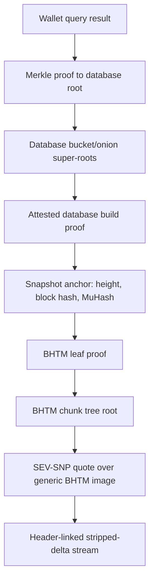

# Website Summary: Database Authenticity and Bitcoin Anchoring

Date: 2026-06-26

This is a source draft for updating the public BitcoinPIR website:
https://bitcoin-pir.github.io/website/

The current site already explains the PIR query privacy story. This summary is
for the complementary authenticity story: how a client can check that a
published BitcoinPIR database root is tied to a particular Bitcoin block hash
and MuHash state.

## Suggested Site Placement

Add a new guide section after the current verification chapter:

```text
14. How we know the database matches Bitcoin
  14.1 The authenticity chain
  14.2 Inside the MuHash proof
  14.3 What is trusted, and what is not
```

Alternative, if the site should stay shorter: add one page under the existing
verification section titled "Database authenticity". Keep it separate from the
"How we verify privacy" pages, because privacy verification and database
authenticity answer different questions.

## One-Paragraph Version

BitcoinPIR needs two independent guarantees. The privacy proof says the server
does not learn which wallet item is being queried from the wire shape. The
authenticity proof says the database being queried is tied to Bitcoin history.
For authenticity, BitcoinPIR publishes database Merkle roots together with an
attested build proof. That proof names a Bitcoin height, block hash, and
Core-style MuHash value. A separate blockhash-to-MuHash proof shows that the
same `(height, block_hash, MuHash)` tuple appears in an append-only MuHash tree
whose root was computed inside an AMD SEV-SNP guest. A client can therefore
walk from a database answer to database Merkle roots, from those roots to the
database build anchor, and from that anchor to a Bitcoin block hash and MuHash
claim.

## Reader-Facing Design

The website should present the design as a chain of small commitments:

```text
PIR answer
  -> bucket/onion database Merkle proof
  -> database Merkle super-root
  -> attested database build proof
  -> database snapshot anchor: height, block_hash, MuHash
  -> BHTM leaf proof for the same height/block_hash/MuHash
  -> BHTM chunk tree root
  -> SEV-SNP quote over the generic BHTM proof runner
  -> Bitcoin header-linked stripped-delta stream
```

In prose:

1. A query result is checked against the database Merkle roots used by the PIR
   server.
2. The database proof binds those roots to a snapshot anchor:
   `(height, block_hash, MuHash)`.
3. A blockhash-to-MuHash leaf proof shows that the same snapshot anchor is a
   leaf under the MuHash chunk tree.
4. The chunk tree root is committed by an AMD SEV-SNP report for the reusable
   BHTM proof-runner image.
5. The proof runner checks header linkage and transaction Merkle roots while
   applying Bitcoin Core-style coin additions and removals to MuHash.

That gives a public, auditable bridge:

```text
database claim -> MuHash claim -> Bitcoin block-hash claim
```

## Component 1: The Database Proof

The database proof is the bridge from BitcoinPIR's served data to a snapshot
anchor. It should be described as:

- The database builder emits Merkle super-roots for the database structures used
  by the PIR backends.
- The proof records the Bitcoin snapshot anchor: `height`, `block_hash`, and
  Core-display `MuHash`.
- The verifier checks that the published database roots and build evidence are
  bound to that snapshot anchor.

For the concrete current database witness:

```text
height:
  948454
block_hash:
  00000000000000000001ef683c02c383315db7e917c69d20f79e05985560a4e4
MuHash:
  cf4fc1f1dd400622a5b6f39eca7f764a30570c30cc668e04f00e8a3356c2a2ee
bucket_super_root:
  e2ba2eee6788424309a95f771893d5401cc8e3ceec6188dc2708900e211a910a
onion_super_root:
  f86baa3966a61cdcd70d8c0ad9bed233f591806eb351db2ae35ac0192a3fe997
```

## Component 2: The Blockhash-to-MuHash Proof

The blockhash-to-MuHash proof, abbreviated BHTM in the local docs, is deliberately
narrow. It is not a Bitcoin node and it does not rebuild the UTXO set. It
receives compact stripped block deltas prepared by a Bitcoin Core-side data
source.

For every block delta, the proof runner checks:

```text
SHA256d(80-byte header) == claimed block_hash
height == previous_height + 1
header.prev_block_hash == previous block_hash
Merkle(SHA256d(stripped_tx_bytes)) == header.merkle_root
```

Then it applies the supplied Bitcoin Core-style coin additions/removals to a
MuHash accumulator and appends this leaf:

```text
height || block_hash || full_384_byte_muhash
```

to an append-only Merkle tree.

The important simplification is that the runner is streaming and low-storage.
It does not store full blocks, does not maintain a Rust `HashMap` UTXO set, and
does not call Bitcoin Core RPC. The heavy state remains on the data source
machine, which already has Bitcoin Core block data, chainstate, and undo data.

## Component 3: The Reusable SEV-SNP Image

The BHTM proof runner is packaged as a reusable AMD SEV-SNP UKI image. Chunk
specific data is not hard-coded into the image. Instead, each run receives a
canonical `job.json`, and the attestation binds:

```text
job_sha256 = SHA256(canonical_job_json)
```

This matters for the public story because it lets verifiers pin one image
measurement while still accepting different Bitcoin chunk jobs. The current
streaming proof image uses a streaming pipeline:

```text
curl | tee(hash fifo) | zstd -dc | blockhash-to-muhash job-teed -
```

The guest uploads proof artifacts only after the compressed stream hash matches
the runtime job. This avoids needing to store both compressed and decompressed
large chunks in guest tmpfs.

All archived chunks from `mainnet-000000-099999` through the partial current
head chunk `mainnet-900000-954920` have been proven with the same streaming UKI
measurement:

```text
652f8c813382abb0c09a7bdc6528e6a3494f9f0833eb087349ad5dac76dec140532763fec8eeaf3fa52723b6a5de8279
```

## Concrete End-to-End Witness

The current checked example ties the database proof anchor at height `948454`
to the BHTM proof for chunk `mainnet-900000-954920`.

The BHTM leaf proof says:

```text
chunk:
  mainnet-900000-954920
height:
  948454
leaf_index:
  48454
tree_size:
  54921
block_hash:
  00000000000000000001ef683c02c383315db7e917c69d20f79e05985560a4e4
Core-display MuHash:
  cf4fc1f1dd400622a5b6f39eca7f764a30570c30cc668e04f00e8a3356c2a2ee
BHTM tree_root:
  babeea635812c3b1a2d5f352ab0a5d1ee8a4e9c668c43c05d6603ef3c3766ba6
leaf_hash:
  0171a475dc43b97db594c7512039d12f5213d270b42e56babfa44d65359eeaaf
proof_steps:
  16
```

The BHTM chunk proof says the same `tree_root` is committed by a SEV-SNP quote,
and the AMD VCEK/report-signature verification passed.

The DB proof accepts the same height, block hash, and Core-display MuHash, then
binds them to the database Merkle super-roots above.

This is the website-ready claim:

> For the current published database witness at height 948454, the database
> Merkle roots are tied to the same block hash and MuHash that appear in the
> BHTM chunk proof. The BHTM chunk proof is bound to a reusable SEV-SNP image
> measurement, and the AMD report signature verifies.

## What A Verifier Checks

A public verifier should be able to check the chain with these inputs:

1. The database answer and its bucket/onion Merkle proof.
2. The database proof bundle for the corresponding database build.
3. The database proof's snapshot anchor: `height`, `block_hash`, `MuHash`.
4. The BHTM leaf proof for that height.
5. The BHTM chunk proof artifacts:
   `attestation.bin`, `report-data.bin`, `sev-snp-report.bin`, `stats.json`,
   and canonical `job.json`.
6. The AMD SEV-SNP report signature / VCEK chain for the BHTM quote.
7. The pinned BHTM UKI measurement and binary hash policy.

Verification then checks:

```text
database answer Merkle path -> database super-root
database proof super-root -> snapshot height/block_hash/MuHash
BHTM leaf proof height/block_hash/MuHash -> BHTM tree_root
BHTM attestation tree_root -> SEV-SNP REPORT_DATA
SEV-SNP report -> AMD signature and expected UKI MEASUREMENT
```

## Trust Boundary To State Clearly

Do not oversell the BHTM proof. It proves a narrow computation:

> Given these header-bound stripped transaction commitments and these supplied
> Bitcoin Core-format coin deltas, this MuHash value and MuHash tree root were
> computed by the measured proof runner.

It does not prove:

- proof of work or difficulty validity;
- script, signature, or witness validity;
- coinbase maturity or subsidy;
- absence of double spends;
- UTXO membership from first principles;
- BIP30 / duplicate-txid behavior by itself;
- genesis or unspendable-output filtering by itself.

Those rules live in the data source/extractor, which must follow Bitcoin Core's
coinstats and undo-data semantics. This is especially important for historical
duplicate txids: the BHTM runner intentionally does not keep enough UTXO state
to rediscover Core's behavior. It consumes exactly the additions/removals the
data source provides.

The honest public phrasing is:

> The attested MuHash runner checks the chain of block headers and the txid
> Merkle root commitments, then applies Core-format UTXO deltas. It is a compact
> computation proof for the MuHash transition, not a full Bitcoin consensus
> validator.

## Suggested Website Copy

### Page 14.1: The Authenticity Chain

BitcoinPIR's privacy proof answers: "what does the server learn from my query?"
The database authenticity proof answers a different question: "is the database I
am querying tied to Bitcoin history?"

The answer is a chain of commitments. A PIR response is checked against database
Merkle roots. Those roots are checked against an attested database build proof.
The database build proof names a Bitcoin block height, block hash, and MuHash.
A separate BHTM proof shows that the same block hash and MuHash appear in a
chunk-level MuHash tree. Finally, an AMD SEV-SNP quote binds that chunk tree root
to the measured proof-runner image.

### Page 14.2: Inside The MuHash Proof

The MuHash proof runner is intentionally small. It does not run Bitcoin Core and
does not store the UTXO set. Instead, it receives a stream of stripped block
deltas prepared next to Bitcoin Core. For each block it recomputes the block
header hash, checks the previous-header link, recomputes the txid Merkle root
from raw stripped transactions, and applies supplied Core-style coin additions
and removals to MuHash.

This is why the proof can run with very little memory: the guest only needs the
MuHash accumulator, a Merkle frontier, and the last processed block metadata.

### Page 14.3: What Is Trusted

The proof is deliberately split. The BHTM guest proves that a small measured
program computed MuHash and a tree root from a streamed input. The data source is
responsible for producing Bitcoin Core-compatible additions and removals,
including undo-data behavior, duplicate txids, genesis handling, and
unspendable-output filtering.

That split keeps the attested computation small and cheap, but it should be
shown honestly. The website should say "attested MuHash transition from
Core-style deltas", not "full Bitcoin consensus validation in the TEE".

## Suggested Diagram



## Source Map For Site Citations

Use these local source references when updating the website or
`CONTENT-AUDIT.md`:

- `README.md:3-28`: slim builder purpose, narrow attested chain, data source
  responsibility, continuation anchors.
- `README.md:56-77`: attestation payloads, report-data binding, runtime
  `job.json`, `job_sha256`, and stable generic SEV-SNP measurement design.
- `docs/BLOCK_HASH_MUHASH_BINDING_STREAMING.md:12-46`: exact BHTM trust
  boundary and non-goals.
- `docs/BLOCK_HASH_MUHASH_BINDING_STREAMING.md:50-81`: compact binary record,
  raw stripped transaction bytes, and duplicate-txid/Core-coinstats boundary.
- `docs/BLOCK_HASH_MUHASH_BINDING_STREAMING.md:83-109`: low-storage design and
  security statement.
- `handoff-summary.md:18-30`: implemented/enforced behavior, streaming batch
  inversion, no UTXO set, no RPC.
- `handoff-summary.md:83-98`: workflow/storage notes and verified archive
  status.
- `handoff-summary.md:106-120`: generic proof tooling and `job-teed`.
- `handoff-summary.md:248-266`: why the streaming UKI replaced the tmpfs-heavy
  fixed image.
- `handoff-summary.md:555-592`: partial-head chunk proof status and uniform
  streaming UKI measurement across all chunks.
- `TRUST-CHAIN-948454.md:8-19`: concrete end-to-end chain.
- `TRUST-CHAIN-948454.md:56-85`: BHTM leaf proof and quote verification for
  height 948454.
- `TRUST-CHAIN-948454.md:87-140`: DB proof link, accepted roots, and local
  verifier caveat.
- `AGENTS.md:332-382`: all archived chunks proven with the same streaming UKI,
  current design, and explicit non-goals.

The public site currently presents "How we verify privacy" as section 13 with a
three-page explanation of leakage-record verification. The database authenticity
story should be adjacent to that chapter, not merged into the privacy claim.
